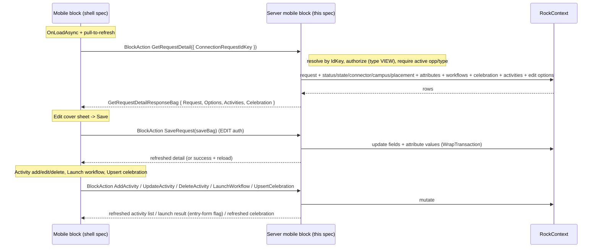

# Connection Request Detail (Mobile) Backend

## Summary

This is the backend half of the new mobile **Connection Request Detail** block, block 5 in the Connections revamp port (after the [Connection Type List](260608-mobile-connection-type-list.md), the [Connection Type Detail](260608-mobile-connection-type-detail.md), the [Connection Opportunity Detail](260609-mobile-connection-opportunity-detail.md), and [My Connection Requests](260609-mobile-my-connection-requests.md)). It is the screen a connector lands on after tapping a request in the [Connection Opportunity Detail](260609-mobile-connection-opportunity-detail.md) request list or in [My Connection Requests](260609-mobile-my-connection-requests.md); both navigate with the `ConnectionRequest` IdKey page parameter. This spec covers only the server-side code in the Develop repo: a new mobile `RockBlockType` that loads one request's full detail, supports editing it, lists and mutates its activities, launches its manual workflows, and reads/writes its celebration; plus security, configuration delivery, and GUID registration. The mobile shell (header, sections, edit cover sheet, activity list, workflow buttons, navigation) is specified separately in [the mobile shell spec](../../RM/specs/260610-mobile-connection-request-detail-shell.md) in the RM repo. The two halves share one `BlockTypeGuid`.

**The UI is still evolving, so this spec is intentionally higher-level than the first four.** It pins the contract, the server actions, the data each action returns or accepts, security, and the conventions, but it leaves precise UI decomposition (how many cover sheets, which fields edit inline vs in a sheet) to be finalized in the shell spec once the design firms up.

**Source of truth.** Unlike the first four blocks, there is **no standalone web `ConnectionRequestDetail` Obsidian block** in the revamp. The revamped request-detail UI lives in the web **Connections Hub** docked panel ([connectionRequestDockedPanel.partial.obs](../Rock.JavaScript.Obsidian.Blocks/src/Engagement/ConnectionsHub/connectionRequestDockedPanel.partial.obs)) served by [ConnectionsHub.cs](../Rock.Blocks/Engagement/ConnectionsHub.cs) (block `8674FB3A-9E0E-421C-821C-2DA862A20ED2`). That panel and its bags are the canonical logic this block adapts. The existing native mobile detail block (see below) is the reference for the mobile-shaped pieces (attribute DTOs, workflow-entry navigation, placement member attributes).

## Motivation

- Core revamped Connections on the web. After the per-type, per-opportunity, and request-list navigation (blocks 1 to 4), a connector opens an individual **request** to work it: read who it is, change its status/state, reassign the connector, set a placement group, edit comments and custom attributes, log activities, launch manual workflows, and record a celebration. The web does all of this in the Connections Hub docked panel; this block ports that to a full mobile screen.
- A **native** mobile `ConnectionRequestDetail` block already exists ([server](../Rock/Blocks/Types/Mobile/Connection/ConnectionRequestDetail.cs), `MOBILE_CONNECTION_CONNECTION_REQUEST_DETAIL`; [shell](../../RM/Rock.Mobile/Blocks/Connection/ConnectionRequestDetail.cs), `EF537CC9-...`). It predates the revamp: it has no celebration, keys off a `connectionRequestGuid` (Guid) rather than the `ConnectionRequest` IdKey the new list blocks pass, still exposes a legacy `HeaderTemplate` / `ActivityTemplate` Lava surface, and does not match the revamped status/state and activity-feed model. Per the initiative's locked convention (each block is new), this block ships a **new** `BlockTypeGuid` mirroring the revamped web panel and leaves the existing block intact for backward compatibility (decided with Panha 2026-06-10).
- Backward compatibility is a hard rule, so the new block ships alongside the existing one rather than replacing it.

## Scope

- In scope (v1 = the named feature set, editable):
  - **Load** one request's detail: requester (name + photo), connection **opportunity** (name + icon), connection **type**, **status**, **state** (with follow-up date when Future Follow Up), **connector**, **campus**, **placement group** (assigned group + role + status), **comments**, **due status**, **custom attributes**, the **manual workflows** available to launch, the **celebration** text, and the **activity list**.
  - **Edit / save** of the core request fields: status, state (+ follow-up date), connector, campus, placement group (group + role + status + group-member attributes), comments, and the request's custom attribute values.
  - **Activities**: list, add, edit, and delete a request activity (activity type + note + connector).
  - **Workflows**: list the request's manual connection workflows and launch one (returning whether it needs an interactive entry form).
  - **Celebration**: read the celebration text and upsert/clear it (the `CELEBRATION_NOTE`), graduating blocks 3/4's display-only has-celebration flag to a viewable + editable note.
  - Security, configuration delivery (campus list + linked pages), SystemGuid registration, and the contract returned.
- Out of scope (this spec):
  - All mobile UI, which lives in the shell spec.
  - **Full web-panel parity** (deferred for v1, per scope decision 2026-06-10): the request **source** field, **person notes** on the requester, the requester's **other open requests** (`AdditionalRequests`), the **AI summary**, and **reminders**. The web panel has these; mobile v1 does not. The contract is shaped so they can be added later without reshaping it.
  - **Transfer** of a request to another connector/opportunity (the existing native block has it; not in the named set; see Open Questions).
  - Later/sibling blocks: **Add Request** (the existing `AddConnectionRequest` block, `1380115A-...`, is left intact; a revamped add flow is a separate future block).
  - Communication actions (SMS/email the requester) shown in the web panel.

## Requirements

### Functional (server) — load

- The block MUST resolve the target `ConnectionRequest` from the `ConnectionRequest` IdKey on the request bag (the shell passes the `ConnectionRequest` page parameter it was launched with by block 3 or block 4). Resolve via `ConnectionRequestService.Get( key, !PageCache.Layout.Site.DisablePredictableIds )` (the overload transparently accepts an Id, IdKey, or Guid, so a Guid from the old navigation path still resolves).
- The block MUST authorize using Entity-based security on the request's **connection type** (`VIEW` for read, `EDIT` for any mutation), mirroring the web's `CanEditConnectionRequest` gate and the [Connection Opportunity Detail](260609-mobile-connection-opportunity-detail.md) block. A missing request, or an inactive opportunity/type, MUST return `ActionBadRequest`; unauthorized MUST return `ActionUnauthorized`.
- The load action MUST return, for the resolved request:
  - Requester display name and photo URL (full public URL when a photo exists, else null; the shell supplies the avatar fallback, as in blocks 3/4).
  - Opportunity name + icon, connection type name.
  - Connection `state` and (when Future Follow Up) the follow-up date; current `status` (name + highlight color); `campus` name; `connector` display name; created date; due date; computed `DueStatus` (same buckets as blocks 3/4).
  - Comments as plain text (markdown column, so `ConvertMarkdownToHtml().StripHtml()`), consistent with blocks 3/4.
  - Placement group summary (assigned group name + icon + the member role/status), when one is assigned.
  - The request's **custom attributes** for view (`GetPublicAttributesForView` / `GetPublicAttributeValuesForView`), shaped as the mobile attribute DTO (see Attributes).
  - The **manual workflows** available for this request (the opportunity's and type's `ConnectionWorkflow`s with `TriggerType == Manual`, filtered by `ManualTriggerFilterConnectionStatusId` and `WorkflowType.IsActive` + `IsAuthorized(VIEW)`), as a launchable list.
  - The **celebration** text, if a non-empty `CELEBRATION_NOTE` exists.
  - The **activity list** (see Activities).
- The load action MUST also return the **edit option lists** the shell needs to populate the edit UI without extra round trips: the available `ConnectionStatuses` for the type (name + color + order + note-required-on-completion + default + sequential-mode disabled flag), the selectable `ConnectionStates` (honoring whether Future Follow Up is enabled for the type), the connectors available for assignment, the placement groups available for the opportunity (with roles/statuses), and the activity types available for logging. These mirror the web `ConnectionRequestDetailOptionsBag`. (Whether these ride on the load response or come from a separate `GetEditOptions` action is an implementation choice; see Design.)

### Functional (server) — edit / save

- The block MUST expose a save action that updates the editable fields of one request: status (+ optional status-history note), state (+ follow-up date), connector, campus, placement group (group + role + status + placement group-member attribute values), comments, and the request's custom attribute values. This mirrors the web `SaveConnectionRequest`.
- Saving MUST enforce `EDIT` authorization on the connection type, MUST `LoadAttributes` before applying values, MUST apply attribute values via `SetPublicAttributeValues( ..., enforceSecurity: true )`, and MUST persist within a `rockContext.WrapTransaction(...)` that calls `SaveChanges()` then `SaveAttributeValues(rockContext)` (the established pattern from the existing block and `AddConnectionRequest`).
- The block MUST honor the type's status rules surfaced in the web options: **note-required-on-completion** (`IsNoteRequiredOnCompletion`) and **sequential status mode** (`IsSequentialStatusMode` disabling out-of-order statuses). Whether these are enforced server-side, surfaced to the shell as flags for client validation, or both, is an Open Question.
- **Completing a request** (state to `Connected`) MUST follow the web's requirement handling when the type `RequiresPlacementGroupToComplete` and the placement group has unmet member requirements (the web checks requirements and supports a manual override). The depth of this on mobile v1 is an Open Question; at minimum the block MUST not silently complete a request whose requirements are unmet when the type requires them.
- `RockDateTime` only; the campus filter and any Guid inputs are resolved to ids before LINQ `.Where()` where a cached id is available ([CLAUDE.md](../CLAUDE.md)).

### Functional (server) — activities

- The block MUST return the request's **activity list** for display, ordered most-recent first, each entry carrying: the activity type name, the note text (plain), the connector/author display name + photo, the activity date, and the activity's IdKey (for edit/delete).
- The block MUST expose **add**, **edit**, and **delete** activity actions, mirroring the web `AddActivityForRequests` / `UpdateActivity` / `DeleteActivity`. Add/edit take an activity type (from the type's available `ConnectionActivityType`s), a note, and a connector person-alias; delete takes the activity IdKey. All require `EDIT` authorization. After a successful add/edit/delete the action SHOULD return the refreshed activity list (the existing mobile block returns the refreshed request view model).
- **System-update entries** (the web feed interleaves auto-generated status/state-change entries via `ActivityEntryBag.SystemUpdate`). Whether mobile v1 shows only user `ConnectionRequestActivity` entries (parity with the existing mobile block) or the richer mixed feed is an Open Question; the recommendation is user activities only for v1.

### Functional (server) — workflows

- The block MUST list the request's **manual** connection workflows (see load) and expose a **launch** action that runs one against the request, mirroring the existing mobile block's `LaunchWorkflow` and the web `LaunchWorkflowForRequests`.
- The launch action MUST report whether the launched workflow has an **active entry form** for the current person. When it does, the shell navigates to a Workflow entry page (a `LinkedPage` block setting), passing the workflow type; when it does not, the workflow runs in the background and the shell shows a success/error message. The action returns the entry-form flag plus any error messages (the existing `ConnectionWorkflowLaunchedViewModel` shape).
- Launching requires `EDIT` (or at least `VIEW` of the workflow type per the web filter); follow the existing block's authorization.

### Functional (server) — celebration

- The block MUST return the request's celebration text (the non-empty `CELEBRATION_NOTE` text, `NoteType` GUID `A480E95A-F941-473E-B200-50D2658C9417`) on load, and MUST expose an **upsert** action that creates, updates, or clears that note for the request, mirroring the web `UpsertCelebrationText`. Clearing (empty text) SHOULD remove the note so the badge/section disappears, consistent with how blocks 3/4 derive the has-celebration flag from a non-empty note.
- Editing the celebration requires `EDIT` authorization. The type's `AreCelebrationsEnabled` flag SHOULD be surfaced so the shell can hide the celebration affordance when the feature is off (note: blocks 3/4 deliberately did **not** consult this flag for the read-only badge, but here, where celebration is editable, the edit affordance should respect it).

### Non-functional / conventions (server)

- A single new `BlockTypeGuid` MUST be embedded identically as a string literal in both repos (shared with the mobile block in the shell spec), with new `EntityTypeGuid` + `BlockTypeGuid` SystemGuid constants.
- Server block: `RockBlockType`, `[SupportedSiteTypes( Model.SiteType.Mobile )]`, under `Develop/Rock.Blocks/Mobile/Connection/` (namespace `Rock.Blocks.Mobile.Connection`; new blocks go in the `Rock.Blocks` project, following `Rock.Blocks/Mobile/CheckIn/CheckIn.cs`).
- The block declares `RequiredMobileVersion => new Version( 1, 20 )` (mobile shell v20). The feature ships in Rock core v20.
- Leave the existing server mobile block (`MOBILE_CONNECTION_CONNECTION_REQUEST_DETAIL`, shell GUID `EF537CC9-...`) and the existing `AddConnectionRequest` block (`1380115A-...`) intact.
- Follow [Develop/CLAUDE.md](../CLAUDE.md) and [data-model.md](../.claude/rules/data-model.md): `RockContext` lifetime, `RockDateTime`, no `System.Web` in shared code, batched note fetch (no per-row queries), avoid `Guid` in `.Where()` when a cached id is available. Attributes declared per [block-architecture.md](../.claude/rules/block-architecture.md) (vertical `FieldAttribute` by property; keys in a nested `AttributeKey` class; page-parameter keys in `PageParameterKey`).

## Design

### Server block identity and placement

| Piece | Path | Notes |
|---|---|---|
| New server block | `Develop/Rock.Blocks/Mobile/Connection/<BlockName>.cs` | Class `<BlockName>` (name TBD, see Open Questions), `[DisplayName("Connection Request Detail")]`, new `EntityTypeGuid` + `BlockTypeGuid`. |
| Existing server block | `Develop/Rock/Blocks/Types/Mobile/Connection/ConnectionRequestDetail.cs` (`MOBILE_CONNECTION_CONNECTION_REQUEST_DETAIL`) | Untouched. Already native (its Lava `ActivityTemplate` is unused in shell V4); strong reference for the mobile-shaped pieces. |

The user-facing `DisplayName` is "Connection Request Detail" (it will coexist with the existing native block of the same name in the `Mobile > Connection` category, as with blocks 1 to 4). The class/namespace name (`<BlockName>` throughout) is decided at implementation start. The server namespace is `Rock.Blocks.Mobile.Connection` (new project location, decided 2026-06-10), where no legacy class collides; in the shell's `Rock.Mobile.Blocks.Connection` namespace the existing block still occupies `ConnectionRequestDetail`, so the shell class needs a distinct name. Block 1 set the naming pattern (`ConnectionTypeListV2`). This is separate from the web `ConnectionsHub` block whose logic we adapt. The same `BlockTypeGuid` literal is shared with the mobile block (see shell spec).

### Block settings (attributes)

Declared per [block-architecture.md](../.claude/rules/block-architecture.md): each `FieldAttribute` assigned vertically by property, keys in a nested `AttributeKey` static class. v1 carries forward the linked pages the existing native block already uses (so navigation out of the screen works) plus the standard config:

| Setting | Field type | Key | Default | Purpose |
|---|---|---|---|---|
| Person Profile Page | `LinkedPage` | `PersonProfilePage` | none | Opened when the requester is tapped; the requester's `PersonGuid` is passed. |
| Group Detail Page | `LinkedPage` | `GroupDetailPage` | none | Opened when the placement group is tapped; the group's identifier is passed. |
| Workflow Page | `LinkedPage` | `WorkflowPage` | none | Opened when a launched manual workflow needs an interactive entry form; the workflow type is passed. |

There is no `HeaderTemplate` / `ActivityTemplate` Lava setting: the new block renders natively (the initiative's locked "no admin Lava row/section templates" rule). Whether to keep a parity `HeaderTemplate` setting is an Open Question. The campus list is delivered via configuration (all active campuses from `CampusCache.All()`), not a setting. Reminder/transfer settings from the existing block are omitted (out of scope for v1).

### Data flow

Static configuration (campus list + linked pages) is delivered through `GetMobileConfigurationValues()`. Everything per-request flows through block actions. The detail is loaded once on entry (and on pull-to-refresh); each mutation returns the affected slice (or signals the shell to reload), the same shape the existing native block uses.

### What the load returns (adapted from the web panel)

The load assembles the same data the web `GetConnectionRequestDetails` returns into its `ConnectionRequestDetailBox` (`ConnectionRequestDetailsBag` + `ConnectionRequestDetailOptionsBag`), narrowed to the v1 scope. Adaptations from the web:

- **Comments** returned as plain text (markdown stripped), like blocks 3/4 (the web returns raw markdown for a rich editor).
- **Attributes** shaped as the mobile attribute DTO (`ClientEditableAttributeValueViewModel`, see Attributes), not the Obsidian `Dictionary<string, PublicAttributeBag>` + values shape.
- **Workflows** returned as a launchable list (name + the connection-workflow identifier needed by the launch action), mirroring the web `ActionItems` / `ConnectionWorkflowBag`.
- **Celebration** returned as the note text (a string), not a flag.
- Deferred web fields are not populated: `ConnectionTypeSource` (request source), `PersonNotes`, `AdditionalRequests`, AI summary, `ReminderCount`.

The edit option lists (statuses, states, connectors, placement groups, activity types) mirror `ConnectionRequestDetailOptionsBag`. They MAY ride on the load response (simplest, one round trip, matches the existing native block which returns edit details via `GetRequestEditDetails`) or be split into a lazy `GetEditOptions` action invoked when the edit sheet opens (lighter initial load). Recommendation: return the lightweight display data on load and fetch the heavier edit options lazily when the user opens the edit sheet, mirroring how block 2 lazy-loads its Details metrics. Final split decided in the shell spec.

### Edit / save

Mirrors the web `SaveConnectionRequest( ValidPropertiesBox<ConnectionRequestBag> )`. The mobile save bag carries the editable fields (status guid + optional history note, state + follow-up date, connector person-alias, campus guid, placement group guid + role guid + member status, comments, request attribute values, placement group-member attribute values). The server resolves Guids to ids, applies values, runs the attribute save inside `WrapTransaction`, and re-reads the request for the response. Status/state-specific rules (note-required-on-completion, sequential mode, complete-with-requirements) are handled per Requirements.

The web exposes finer-grained mutations too (`ChangeRequestStatus`, `UpdateRequestStates`, `ReassignConnector`) for quick inline actions on the board. Whether mobile v1 uses a single `SaveRequest` for everything or also offers quick inline status/state/connector actions is a shell decision; the contract can support both (a full save bag plus optional targeted update bags). Recommendation: one `SaveRequest` for v1 to keep the surface small, adding targeted quick-actions later if the UI calls for them.

### Activities

The request activity list comes from `ConnectionRequestActivityService` for the request, projected to a mobile activity bag (type name, note plain text, author name + photo, date, IdKey). Add/edit use the type's available `ConnectionActivityType`s (from `request.ConnectionOpportunity.ConnectionType`); the web also carries each type's `PersonNoteCreationBehavior` and an `AddPersonNote` toggle (person notes are out of v1 scope, so this toggle is omitted unless person notes are pulled in later). Delete removes the activity. All three re-return the activity list. Batched author photos (no per-row queries).

### Workflows

Manual workflows are gathered exactly as the existing mobile block does (`opportunity.ConnectionWorkflows.Union( opportunity.ConnectionType.ConnectionWorkflows )` where `TriggerType == Manual`, active, status-filter match, `IsAuthorized(VIEW)`), deduped, ordered by name. The launch action runs the workflow and returns whether it has an active entry form (`HasActiveEntryForm`) plus errors. The shell navigates to the `WorkflowPage` linked page for entry forms, else shows a toast. Reuse the existing `LaunchWorkflow` shape rather than the web's bulk `LaunchWorkflowForRequests` (single request here).

### Celebration

On load, query the single `CELEBRATION_NOTE` for the request (`NoteTypeCache.Get( SystemGuid.NoteType.CELEBRATION_NOTE.AsGuid() ).Id`, `NoteService` where `NoteTypeId == ... && EntityId == request.Id`) and return its text when non-empty. The upsert action creates/updates that note (or deletes it when text is cleared), mirroring the web. This is the same note blocks 3/4 detect for their badge, so a celebration written here makes the badge appear in those lists.

### Attributes

Use the established **mobile** attribute pattern, not the Obsidian dictionary shape: return `ClientEditableAttributeValueViewModel` (in `Rock.Common.Mobile/ViewModel/`) for view and edit, via `GetPublicAttributesForView/Edit` + `GetPublicAttributeValuesForView/Edit`, and apply with `SetPublicAttributeValues` + `SaveAttributeValues`. The shell renders/edits each value with its FieldType editor (`FieldType.GetEditView` / `SetEditValue` / `GetEditValue`) or the `AttributeValueEditor` control. This matches the existing mobile `ConnectionRequestDetail` and `AddConnectionRequest` blocks.

### Placement group

Display the assigned group (name + icon + the member role/status). Editing a placement group mirrors the web `PlacementGroupDetailsBag`: select a group available for the opportunity, a role, a status, and (optionally) edit the group-member attribute values for that placement. Member **requirements** (`GroupMemberRequirementBag`) gate completion when the type `RequiresPlacementGroupToComplete`; the depth of requirement display/override on mobile v1 is an Open Question. The existing mobile block's `GetPlacementGroupMemberAttributesAndValues` and `MarkRequestConnected` (with manual requirements) are the reference.

### Contract returned

The bags and enums live in `Rock.Common.Mobile` (RM repo) and are defined in full in the [shell spec](../../RM/specs/260610-mobile-connection-request-detail-shell.md). The server references the built `Rock.Common.Mobile.dll` in `RockWeb/Bin`. Property names MUST match the mobile definitions exactly. At a high level the server populates:

- **`GetRequestDetailResponseBag`** { the request display bag, the edit options bag, the activity list, the celebration text }. (Exact split between display and edit options per Design.)
- A **request display bag** mirroring the v1 subset of the web `ConnectionRequestDetailsBag` (requester name/photo, opportunity name/icon, type name, state + follow-up, status name/color, campus, connector, due status, dates, comments plain text, placement group summary, attributes, manual workflows, celebration text).
- An **edit options bag** mirroring the v1 subset of `ConnectionRequestDetailOptionsBag` (CanEdit, statuses, states, connectors, placement groups, activity types, campuses, the AreCelebrationsEnabled / IsSequentialStatusMode / IsFutureFollowUpEnabled / RequiresPlacementGroupToComplete flags).
- A **save request bag** mirroring the v1 subset of the web `ConnectionRequestBag`.
- **Activity** bags for the list and for add/edit (type guid, note, connector, activity IdKey on edit) mirroring the web `ActivityEntryBag` / `ActivityBag`.
- A **launch-workflow result** (entry-form flag + errors) and an **upsert-celebration** request (IdKey + text).
- `Configuration` (from `GetMobileConfigurationValues`) { `Campuses` (active campuses from `CampusCache.All()` as `ListItemViewModel`), the linked-page Guids }.

`ConnectionState` and `DueStatus` already exist in `Rock.Common.Mobile/Enums/` and are reused (do not redefine). New shared enums are introduced only if the activity feed or placement requirements need them (for example `MeetsGroupRequirement` parity); the shell spec is the source of truth for new shared types.

## Open Questions (backend)

1. **Block class / namespace name (decide at implementation start).** Undecided; shown as `<BlockName>`. It cannot reuse the plain `ConnectionRequestDetail` class name while the existing block occupies it in the same mobile namespace. Also decide whether the two same-named blocks in `Mobile > Connection` need a distinguishing display name or whether the old one is eventually deprecated.
2. **Honor per-request security (`EnableRequestSecurity` / `IsRequestSecurityEnabled`)?** This is the same open question carried by blocks 3/4. The detail block authorizes at the connection-type level; a type can enable request-level security, in which case a single request the connector reached by IdKey could still be restricted. Decide whether to add a per-request `IsAuthorized(VIEW/EDIT)` check here. Because this block loads exactly one request, honoring it is cheap (a single in-memory check), unlike block 3's paging concern.
3. **Edit option delivery.** Return the edit option lists (statuses/states/connectors/placement groups/activity types) on the initial load, or lazily via a `GetEditOptions` action when the edit sheet opens? Recommendation: lazy, to keep the initial load light.
4. **Edit granularity.** One `SaveRequest` for all core fields, or also targeted quick-actions (`ChangeStatus`, `UpdateState`, `ReassignConnector`) for inline edits like the web board? Recommendation: single `SaveRequest` for v1.
5. **Status rule enforcement.** Enforce note-required-on-completion and sequential status mode server-side, surface them as flags for client validation, or both?
6. **Complete-with-requirements depth.** How much of the web's placement-group requirement checking + manual override to bring to mobile v1 when completing a request whose type `RequiresPlacementGroupToComplete`.
7. **Activity feed scope.** User `ConnectionRequestActivity` entries only (parity with the existing block), or the web's mixed feed including auto-generated system updates? Recommendation: user activities only for v1.
8. **Transfer.** The named scope excludes transfer, but the existing native block has it. Confirm transfer is deferred for v1 (recommended) rather than carried over.
9. **`HeaderTemplate` parity.** Keep a Lava `HeaderTemplate` block setting for parity with the existing block, or go fully native with no Lava surface (recommended, per the initiative convention)?

## Considered but Rejected (backend)

### Revamp the existing native block in place
Rejected (product decision 2026-06-10). Even though the existing `ConnectionRequestDetail` block is already native (not a Lava-hybrid list block), Panha chose to ship a **new** block with a new `BlockTypeGuid` and leave the existing one intact, consistent with the initiative's "each block is new" convention and preserving backward compatibility for any deployment using the existing block, its `HeaderTemplate`, and its `connectionRequestGuid` navigation contract.

### Full web-panel parity for v1
Rejected for v1 (scope decision 2026-06-10). The request source, person notes, the requester's other open requests, the AI summary, and reminders are part of the web docked panel but are out of v1. The contract is shaped so they can be added later without reshaping it.

### Extract a shared service for the detail/save logic
Rejected for now (product decision), matching the initiative. The web detail/save/activity/workflow logic is block-private to `ConnectionsHub` (and partly duplicated already in the existing mobile block). We adapt it into the new mobile server block rather than refactoring the shipping web block. A future cleanup could unify a `ConnectionRequestClientService`.

### Reuse the existing mobile block's contract verbatim
Rejected. The existing block predates the revamp (no celebration, Guid-keyed navigation, legacy Lava surface, pre-revamp status/state model). The new block mirrors the revamped web panel's model and uses the `ConnectionRequest` IdKey the new list blocks pass, so it gets its own contract. The existing block remains a strong implementation reference for the mobile-shaped pieces.

## Related

- Web source of truth (docked detail panel + actions/bags): [Develop/Rock.Blocks/Engagement/ConnectionsHub.cs](../Rock.Blocks/Engagement/ConnectionsHub.cs) (`GetConnectionRequestDetails`, `SaveConnectionRequest`, `ChangeRequestStatus`, `UpdateRequestStates`, `ReassignConnector`, `AddActivityForRequests`, `UpdateActivity`, `DeleteActivity`, `LaunchWorkflowForRequests`, `UpsertCelebrationText`); [connectionRequestDockedPanel.partial.obs](../Rock.JavaScript.Obsidian.Blocks/src/Engagement/ConnectionsHub/connectionRequestDockedPanel.partial.obs).
- Web detail bags: [Develop/Rock.ViewModels/Blocks/Engagement/ConnectionsHub/](../Rock.ViewModels/Blocks/Engagement/ConnectionsHub) (`ConnectionRequestDetailsBag`, `ConnectionRequestBag`, `ConnectionRequestDetailOptionsBag`, `ActivityEntryBag`, `ActivityBag`, `ConnectionWorkflowBag`, `ConnectionStatusBag`, `PlacementGroupDetailsBag`, `UpsertCelebrationBag`).
- Existing mobile server block (left intact; reference for mobile-shaped pieces): [Develop/Rock/Blocks/Types/Mobile/Connection/ConnectionRequestDetail.cs](../Rock/Blocks/Types/Mobile/Connection/ConnectionRequestDetail.cs).
- Services: `ConnectionRequestService`, `ConnectionRequestActivityService`, `ConnectionWorkflowService`, `NoteService` (celebration). Attribute helpers via `IHasAttributes` (`GetPublicAttributesForEdit` etc.) and `MobileHelper`.
- Enums (reused): `Rock.Enums/Connection/ConnectionState.cs`, `Rock.Enums/Connection/DueStatus.cs`.
- Sibling backend specs: [Connection Type List](260608-mobile-connection-type-list.md), [Connection Type Detail](260608-mobile-connection-type-detail.md), [Connection Opportunity Detail](260609-mobile-connection-opportunity-detail.md), [My Connection Requests](260609-mobile-my-connection-requests.md).
- Mobile shell spec: [../../RM/specs/260610-mobile-connection-request-detail-shell.md](../../RM/specs/260610-mobile-connection-request-detail-shell.md)
